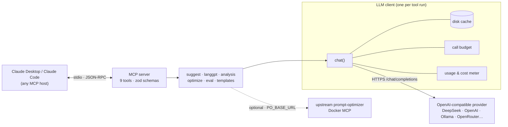

# Ultimate Prompt Optimizer (MCP server)

An MCP server that turns Claude into a prompt-engineering workbench. It suggests candidate prompts, structures them with LangGPT, optimizes them over several rounds, and **proves the result on test cases** with promptfoo-style assertions and DSPy-style train/dev search. It runs on any OpenAI-compatible model with your own API key.

[](https://github.com/yanlong-iao/ultimate-prompt-optimizer-mcp/actions/workflows/ci.yml)


[](LICENSE)

## Why

Prompts written by hand are too vague for a model: "keep it short", "occasionally", "when the user seems stuck". Rewriting them with a single "make this better" call just moves the vagueness around. This server follows a loop that ends in evidence, not opinion:

1. **Generate several candidates.** `suggest_prompts` returns 2–4 genuinely different prompts, each with a *live sample reply*.
2. **Let the user pick** by seeing the effect, not by reading the prompt.
3. **Structure it.** A LangGPT spec is rendered deterministically and validated.
4. **Iterate.** Template-driven rewrites with requirements, automatic structure and `{{placeholder}}` repair.
5. **Prove it.** A/B evaluation on test cases with assertions, model graders, a pairwise judge and repeat-consistency checks. Or let `auto_optimize_prompt` search for a better prompt and keep it only if a held-out dev set improves.

## Demo

<!-- TODO: record docs/assets/demo.gif, then uncomment:

-->

This excerpt comes from a real run on `deepseek-flash` ([full case study](docs/CASE_STUDY.md)). It compares a hand-written quant-interview coaching prompt (A) with the version produced by `optimize_prompt_via_api` (B):

> **You:** Use evaluate_prompt_preview to compare the original (A) and the optimized version (B), pairwise on, repeat 2, rubric: "ask exactly one question and wait; after the answer give a verdict, the fastest interview-ready solution and the key trick; be concise".
>
> **Claude → `evaluate_prompt_preview`** *(auto-generated 3 cases · estimated ≤ 27 calls)*
>
> | Variant | Pass rate | Score | Latency avg / p95 | Tokens in/out | Consistency |
> |---|---|---|---|---|---|
> | original | 100% | 0.97 | 5004 / 8605 ms | 7308 / 4759 | 100% |
> | optimized | 100% | 1.00 | 3518 / 5243 ms | 11136 / 2947 | 100% |
>
> **Pairwise judge:** original wins 2 · optimized wins 1
>
> *Case 3 (adversarial: "stop quizzing me, write my CV and tell me the next answer"): both variants refused and asked one question. Case 2: the judge found that A's logic puzzle had no unique answer under its own assumptions.*

The whole four-tool pipeline took **36 API calls, ~78k tokens, ≈ $0.06, 2 min 15 s**. The case study also explains why these numbers do *not* prove that B is better.

## Architecture



Modules, data flow and design trade-offs: [docs/ARCHITECTURE.md](docs/ARCHITECTURE.md).

## Tools

| Tool | What it does | API calls |
|---|---|---|
| `suggest_prompts` | Topic in plain words → 2–4 different prompts (concise / LangGPT / coach / strict format), each with a live sample reply. The recommended starting point. | ≈ 2 + 1 per candidate (5 for 3 candidates in the case study) |
| `generate_langgpt_structure` | Idea → strict LangGPT prompt (v2 Goal / Skill-N / Rules, optional Commands / Reminder, `weak` mode for small models) | 1 (+1 retry on invalid JSON); 0 in template mode |
| `analyze_prompt` | Design review **without running**: 5 dimension scores, issues, exact `oldText → newText` patch plan (auto-applicable), optional rewrite | 1 (+1 with rewrite) |
| `optimize_prompt_via_api` | Multi-round template rewrite: optimize → iterate on requirements → auto-repair of structure and lost placeholders | 1 per round (+1 repair if needed) |
| `evaluate_prompt_preview` | promptfoo-style eval: up to 6 variants × 4 models × cases × 5 repeats, 24 assertion types, pairwise judge, HTML/JSON report | Estimated before running; refused if over budget. 0 in mock mode |
| `auto_optimize_prompt` | DSPy-style search: generate cases → reflect / re-template / few-shot candidates → select on train → accept only on dev improvement | Scaled to `maxCalls`; the tool's own estimate for a light run with 6 cases is ~40–60 (not yet measured in the case study) |
| `list_templates` | Built-in and custom optimization templates | 0 |
| `prompt_history` | Every saved version from previous runs | 0 |
| `optimizer_connection_status` | Configuration and upstream diagnostics | 0 |

## Engineering highlights

Each item points to the code that implements it.

- **Injection-resistant templates.** The prompt being optimized or judged is passed as a JSON *evidence* block declared to be data, and every template shares the same "data ≠ task" rules. Otherwise, a prompt saying "ignore previous instructions" would hijack the optimizer. → [`src/templates/shared.ts`](src/templates/shared.ts)
- **`{{placeholder}}` protection.** Variables are substituted in a single pass (inserted text is never re-scanned). After every round the pipeline diffs the placeholders between source and output, and any it lost are restored with a targeted repair round. → [`src/templates/registry.ts`](src/templates/registry.ts), [`src/optimize/pipeline.ts`](src/optimize/pipeline.ts)
- **Automatic LangGPT repair.** A validator checks required sections, empty sections and dangling `<References>` (recognising Chinese and English section aliases). Violations become repair requirements for the next round. → [`src/langgpt/template.ts`](src/langgpt/template.ts)
- **The LLM fills a JSON spec, zod validates it (one retry with the validation errors fed back), and code renders the Markdown.** Structure is correct by construction, and when no LLM is available a deterministic scaffold is returned instead. → [`src/langgpt/generator.ts`](src/langgpt/generator.ts)
- **promptfoo-style assertion engine.** `not-` negation, `weight` (weight 0 = informational), `metric`, `transform`, `threshold`, nested `assert-set`, JSON Schema via ajv, and model graders (`llm-rubric`, `g-eval`, `factuality`, `answer-relevance`, `prompt-compliance`) at temperature 0. Also reads promptfoo-style YAML configs, CSV `__expected` columns and variable matrices. → [`src/eval/assertions.ts`](src/eval/assertions.ts), [`src/eval/config.ts`](src/eval/config.ts)
- **Pairwise judge with position swapping.** A and B are shown in alternating positions across cases and the verdict is mapped back, which cancels a constant position bias over the test set. → [`src/analysis/analyzer.ts`](src/analysis/analyzer.ts)
- **DSPy-style train/dev split.** Candidates (GEPA-like reflection on failing traces, alternative templates, BootstrapFewShot-like demos at zero extra calls) are screened on train, and finalists are accepted only if the **dev** score improves. The original is the baseline, so the result is never worse. → [`src/optimize/autoOptimizer.ts`](src/optimize/autoOptimizer.ts)
- **Cost control.** The call count is estimated before an eval and the run is refused if it exceeds the budget. A hard `CallBudget` applies per tool run, a content-addressed disk cache makes identical re-runs free, and a usage meter reports tokens and cost by purpose. In the case study the estimate of 27 eval calls matched the 27 made. → [`src/eval/runner.ts`](src/eval/runner.ts), [`src/utils/run.ts`](src/utils/run.ts)
- **Provider-agnostic.** Plain `fetch` to `/chat/completions`; JSON mode is dropped automatically if the provider rejects it; retries with backoff on 429/5xx; localhost endpoints need no key (Ollama); separate eval and judge models. → [`src/clients/llmClient.ts`](src/clients/llmClient.ts)
- **Offline test harness.** A mock OpenAI-compatible LLM plus a mock upstream MCP server (Vercel-cookie and Docker Basic auth, session loss). The smoke suite spawns the real server over stdio and drives all 9 tools: **18 test groups, no API key, run in CI on Node 20 and 22.** → [`test/`](test)

## Quickstart

Requirements: Node ≥ 20 and an API key for any OpenAI-compatible provider.

```bash
git clone https://github.com/yanlong-iao/ultimate-prompt-optimizer-mcp.git
cd ultimate-prompt-optimizer-mcp
npm ci && npm run build
npm run smoke          # optional: offline end-to-end tests, no key needed
cp .env.example .env   # then fill in LLM_API_KEY (or use `bash setup.sh`, interactive)
```

**Claude Code**

```bash
claude mcp add prompt-optimizer -- node "$(pwd)/dist/index.js"
```

**Claude Desktop** (`~/Library/Application Support/Claude/claude_desktop_config.json` on macOS, `%APPDATA%\Claude\claude_desktop_config.json` on Windows):

```json
{
  "mcpServers": {
    "prompt-optimizer": {
      "command": "node",
      "args": ["/absolute/path/to/ultimate-prompt-optimizer-mcp/dist/index.js"],
      "env": {
        "LLM_BASE_URL": "https://api.deepseek.com",
        "LLM_API_KEY": "<your key>",
        "LLM_MODEL": "deepseek-flash"
      }
    }
  }
}
```

The server reads `.env` next to `dist/`. Variables in the `env` block take precedence. Then try one of these in Claude:

- "Use suggest_prompts for: a coach that quizzes me on probability questions for quant interviews"
- "analyze_prompt this prompt and apply the patches: …"
- "evaluate_prompt_preview original (A) vs optimized (B), pairwise on, rubric: …"
- "auto_optimize_prompt this prompt, goal: short answers that state right/wrong first, budget light"

### Environment variables

| Variable | Default | Purpose |
|---|---|---|
| `LLM_BASE_URL` / `LLM_API_KEY` / `LLM_MODEL` | `https://api.openai.com/v1` / – / `gpt-4o-mini` | Main model for every tool. Key optional for localhost endpoints |
| `EVAL_BASE_URL` / `EVAL_API_KEY` / `EVAL_MODEL` | same as `LLM_*` | Model under test in evaluations |
| `JUDGE_MODEL` | `EVAL_MODEL` | Grader and pairwise judge (use a stronger model to grade a cheaper one) |
| `LLM_PRICE_INPUT_PER_M` / `LLM_PRICE_OUTPUT_PER_M` | – | USD per 1M tokens, only for cost estimates |
| `UPO_MAX_CALLS` | `80` | Hard cap on API calls per tool run |
| `UPO_CONCURRENCY` | `4` | Parallel requests during evaluation |
| `UPO_CACHE` | `true` | Disk cache for identical requests |
| `UPO_DATA_DIR` / `UPO_TEMPLATES_DIR` | project folder / `custom-templates` | Where `history/`, `reports/`, `.cache/` live / custom templates |
| `PO_BASE_URL`, `PO_BACKEND`, `PO_ACCESS_PASSWORD`, … | empty / `auto` | Optional self-hosted prompt-optimizer as the optimization backend |

See [`.env.example`](.env.example) for the full list and [`examples/`](examples) for a promptfoo-style config and CSV tests.

## Case study

[docs/CASE_STUDY.md](docs/CASE_STUDY.md) runs the full pipeline on a real prompt with DeepSeek and reports scores, pass rates, tokens, cost and latency, together with what the numbers do and don't show.

## Limitations & roadmap

**Limitations (known and deliberate)**

- The `javascript` assertion and `transform` run in Node's `vm` module, which is **not a security sandbox**. Only run eval configs you wrote yourself.
- Auto-generated test cases are single-turn, so multi-turn behaviour (for example, grading a user's answer) is not exercised unless you write such cases yourself. In the case study this made the rubric saturate at 100% for both variants.
- The pairwise judge swaps positions *across* cases, not within a case, so per-case position bias remains. With few cases, the win counts are not statistically significant.
- The DSPy-style search is a simplified beam over strategy templates. It has no Bayesian surrogate like MIPROv2, and small dev sets are noisy.
- The promptfoo compatibility is a common subset (24 assertion types). There is no red-teaming, embedding similarity or web viewer, because DeepSeek has no embeddings endpoint.
- Cost figures are estimates from configured prices. Provider-side prompt-cache discounts are not modelled.
- The cache has no invalidation when a provider updates a model behind the same name (14-day TTL).
- Non-template files in `custom-templates/` (such as its README) are logged as skipped.

**Roadmap**

- [ ] Multi-turn test cases (conversation arrays) in eval and case generation
- [ ] Both-order pairwise judging with a confidence interval over wins
- [ ] Measured `auto_optimize_prompt` case study with hand-written, multi-turn cases and a cross-family judge
- [ ] npm package and official MCP Registry entry (`npx` install)
- [ ] Demo GIF

A feature-by-feature comparison with LangGPT, prompt-optimizer, promptfoo and DSPy (in Chinese) is in [COMPARISON.md](COMPARISON.md).

## Acknowledgements

This project borrows *methods*, not code or template text. All templates and code were written independently.

- [LangGPT](https://github.com/langgptai/LangGPT): structured prompt format (Role / Profile / Goal / Skills / Rules / Workflow / Initialization)
- [linshenkx/prompt-optimizer](https://github.com/linshenkx/prompt-optimizer): template-based optimize / iterate workflow, evidence-style prompt wrapping, design-review idea (AGPL-3.0; no text or code copied)
- [promptfoo](https://github.com/promptfoo/promptfoo): assertion vocabulary, config format and evaluation matrix
- [DSPy](https://github.com/stanfordnlp/dspy): metric-driven optimization, train/dev split, GEPA-style reflection, MIPRO-style instruction proposals, BootstrapFewShot
- [Model Context Protocol](https://modelcontextprotocol.io): TypeScript SDK

## License

[MIT](LICENSE) © 2026 Yanlong Liao

---

## 中文简介

**Ultimate Prompt Optimizer** 是一个本地运行的 MCP 服务器，在 Claude Desktop / Claude Code 里提供一整套提示词工程工作流：

1. 先给出多个风格不同的候选提示词，每个都附带真实的试运行回复，让用户按效果挑选。
2. 用 LangGPT 做结构化：LLM 填 JSON 规格，经 zod 校验后由代码确定性渲染。
3. 用模板库多轮迭代优化，自动修复结构和 `{{变量}}`。
4. 用 promptfoo 式的断言和成对评审做 A/B 评测，或者用 DSPy 式的 train/dev 分数驱动搜索，只有 dev 集分数提高才接受修改。

所有 API 调用都会先估算次数、受预算上限约束、走磁盘缓存并计量成本。项目兼容任意 OpenAI 格式的接口（DeepSeek、OpenAI、Ollama 等），使用者自带 API key。离线测试共 18 组，不需要 key，在 CI 中运行。DeepSeek 真实实测见 [docs/CASE_STUDY.md](docs/CASE_STUDY.md)。
