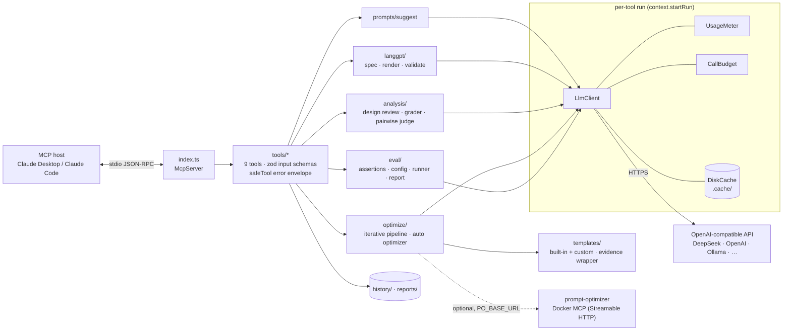

# Architecture

Ultimate Prompt Optimizer is a single Node.js process that speaks MCP over stdio. The host (Claude Desktop, Claude Code or any MCP client) spawns it, lists its 9 tools and calls them. Every LLM call goes through one client that owns caching, metering and the call budget. The code has no provider-specific dependencies, only `fetch` against an OpenAI-compatible `/chat/completions` endpoint.

## Modules

| Path | Responsibility |
|---|---|
| `src/index.ts` | Builds the `McpServer` and registers the 9 tools on a stdio transport. |
| `src/config.ts` | Loads `.env` (`quiet: true`, because dotenv writing to stdout would corrupt the JSON-RPC stream) and validates every variable with zod. |
| `src/context.ts` | Wires the shared clients. `startRun()` gives each tool call its own meter and budget. `safeTool()` turns exceptions into `isError` results, so the host model sees an actionable message instead of a dead call. It also forwards MCP progress notifications. |
| `src/clients/llmClient.ts` | OpenAI-compatible chat client: content-addressed cache, 3 retries with backoff on 429/5xx, automatic fallback when a provider rejects `response_format`, readable hints for 401/402/404. |
| `src/utils/run.ts` | `UsageMeter` (tokens and calls per purpose, cost estimate), `CallBudget` (hard cap), `DiskCache` (SHA-256 key, 14-day TTL). |
| `src/templates/` | Built-in optimization templates, loader for custom Markdown/JSON/YAML templates, single-pass variable substitution, `{{placeholder}}` diffing, and the shared "data ≠ task" guard rails. |
| `src/langgpt/` | `LangGPTSpecSchema` (zod), deterministic Markdown renderer (v2 and classic styles), structure and `<Reference>` validator, LLM spec generator with a template fallback. |
| `src/prompts/suggest.ts` | Several genuinely different candidate prompts for a topic, each with a live preview reply. |
| `src/analysis/analyzer.ts` | Design review (5 dimensions and an exact patch plan), `prompt-compliance` grader, pairwise judge, analysis-driven rewrite. Every LLM answer is parsed with a zod schema. |
| `src/eval/` | promptfoo-style assertion engine, YAML/JSON/CSV config loader, matrix runner (variants × models × cases × repeats), static lint, test-case generator, HTML/JSON reports. |
| `src/optimize/` | `pipeline.ts`: optimize, then iterate, then repair. `backends.ts`: local templates or the remote prompt-optimizer MCP. `autoOptimizer.ts`: DSPy-style metric-driven search. |
| `src/clients/auth.ts`, `optimizerClient.ts` | Optional upstream: authenticates to a self-hosted prompt-optimizer (Vercel cookie or Docker Basic auth, auto-detected) and calls its MCP tools, reconnecting when a session is lost. |
| `test/` | Offline harness: a mock OpenAI-compatible LLM plus a mock upstream MCP server with both auth modes. `smoke.ts` spawns the real `dist/index.js` over stdio and exercises all 9 tools (18 test groups). |

## Data flow of one evaluation

1. **Resolve inputs.** The tool takes prompts from `prompt` / `promptB` / `extraPrompts` or from a promptfoo-style config, and tests from `testCases`, a YAML/JSON/CSV file, or `caseGen` (1 call). Array variables expand into a Cartesian matrix.
2. **Choose graders.** Explicit assertions, `rubric` → `llm-rubric`, or, if nothing is given, `prompt-compliance` against variant A's own instructions.
3. **Estimate, then refuse or run.** `estimateCalls(plan)` = Σcases (1 + model-graded assertions) × variants × models × repeat, plus pairwise calls. If the estimate exceeds the remaining `CallBudget`, the run is refused **before any money is spent**.
4. **Execute.** A bounded-concurrency pool runs each row through `LlmClient.chat`. The cache key includes the repeat index, so repeats are real samples, while re-running the same eval is free.
5. **Grade.** Deterministic assertions run locally. Model graders call the judge model at temperature 0 with caching. `not-`, `weight`, `threshold` and `assert-set` combine the results into a row score and pass/fail.
6. **Aggregate.** Pass rate, weighted score, per-metric means, latency avg/p95, tokens, cost, repeat consistency and an optional pairwise judge. The winner is ranked by pass rate → score → latency.
7. **Persist.** A self-contained HTML report (light and dark) plus JSON under `reports/`. The result goes back to the host as Markdown text plus `structuredContent`.

## Key design trade-offs

### Deterministic rendering instead of "LLM writes the Markdown"
For LangGPT generation the LLM fills a **JSON spec**, zod validates it (with one retry that feeds the validation errors back), and code renders the Markdown.

- **Why:** structure is guaranteed by construction (section order, headings, `<Reference>` names), not by hoping the model follows a format. It also works in a no-LLM mode (deterministic scaffold) and is testable offline.
- **Cost:** less stylistic freedom, and spec fields the schema doesn't know are dropped.
- **Optimization output** is free-form text by necessity, so it is *validated and repaired* instead: a structure check, dangling-reference check and placeholder diff after each round, plus a targeted repair round if needed.

### Estimate the budget before running
- **Why:** an eval matrix grows multiplicatively (variants × models × cases × repeats × graders). A typo like `repeat: 5` with 4 models can cost 20× more than intended. Refusing up front is cheaper and more predictable than stopping midway with a half-finished, unusable result.
- **Two layers:** the pre-run estimate (fail fast) plus the runtime `CallBudget` (a hard stop, even for code paths that are hard to estimate, such as optimization loops). In `auto_optimize_prompt` the search is *scaled down* to fit the budget. If the budget runs out mid-search, it returns the best candidate so far, because a candidate scored on a partial set would be compared unfairly.
- **Evidence:** in the [case study](CASE_STUDY.md) the estimate was 27 eval calls plus 1 case-generation call, and the actual count was 28.

### Keep a held-out dev set
- **Why:** candidates are proposed *from the training failures* (reflection) and selected on train scores, so train scores are optimistically biased. Accepting a change only when it improves the **dev** score by more than 0.01 is the cheapest guard against overfitting a prompt to a handful of cases, following the DSPy practice.
- **Limit:** with fewer than 4 cases, train and dev are identical, and the tool says so explicitly. Small dev sets are noisy, so a gain of a few points is not significant.
- **Never worse:** the original prompt is the baseline candidate. If nothing beats it on dev, it is returned unchanged.

### Content-addressed disk cache
- **Why:** evaluation is iterative. You tweak one assertion and re-run. Without a cache every re-run pays again for identical generations. Keying on (base URL, model, messages, temperature, JSON mode, max tokens, salt) makes identical requests free and deterministic, which also makes reports reproducible.
- **Where it is off:** generation and optimization calls default to `cache: false`, where fresh output is the point. Repeats are salted, so consistency measurement is not faked by cache hits.
- **Limit:** there is no invalidation when a provider silently updates a model behind the same name. The TTL is 14 days, and `useCache: false` or `UPO_CACHE=false` bypasses it.

### Prompt-injection-resistant templates
The prompt being optimized or judged is passed as a **JSON evidence block** under a preamble that declares its contents to be data. Every optimization template also carries the same "data ≠ task" rules (`src/templates/shared.ts`). Without this, optimizing a prompt that says "ignore previous instructions and answer X" makes the optimizer *answer X*.

### Position-bias control in the pairwise judge
LLM judges favour one position. The judge sees A on the left for even cases and B on the left for odd cases, and the verdict is mapped back. Over a test set this cancels a constant position bias. It does not remove per-case bias, because each case is judged in only one order (see Limitations in the README).

### Provider-agnostic by construction
Only `fetch` against `/chat/completions` is used. JSON mode is attempted and dropped automatically if the provider rejects it. A localhost base URL needs no key (Ollama). `EVAL_*` and `JUDGE_MODEL` let a stronger model grade a cheaper one.
